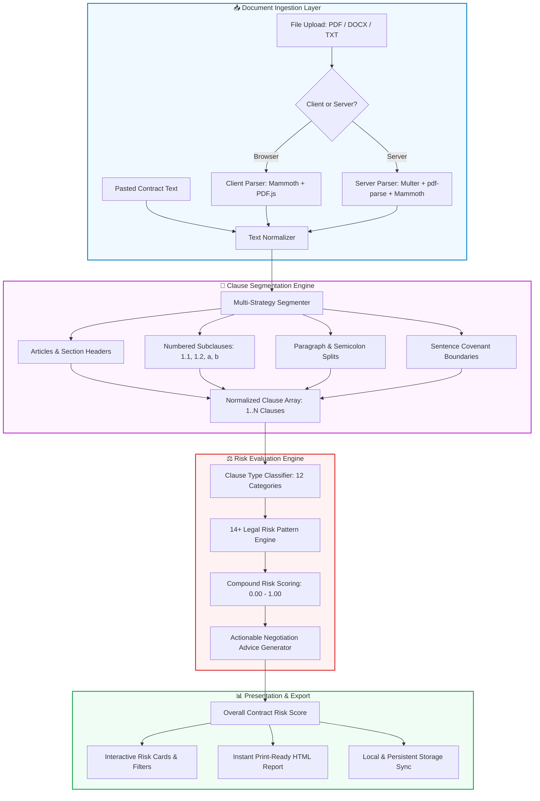

<div align="center">

# ⚖️ SmartReviewAI — AI Contract Risk Analyzer

<p align="center">
  
</p>

<p align="center">
  <strong>Analyze agreements, detect unfavorable terms, score legal liabilities, and get actionable negotiation advice in seconds.</strong>
</p>

<p align="center">
  <a href="#-quick-start"></a>
  <a href="#-tech-stack"></a>
  <a href="#-license"></a>
</p>

<p align="center">
  
  
  
  
  
  
  
</p>

---

[🚀 Quick Start](#-quick-start) •
[✨ Key Features](#-key-features) •
[🏛️ Architecture](#️-architecture) •
[⚖️ Risk Detection Engine](#️-risk-detection-engine) •
[📑 API Reference](#-api-reference) •
[📱 Mobile App (APK)](#-mobile-app-apk) •
[📂 Project Structure](#-project-structure)

---

</div>

## 🌟 Overview

**SmartReviewAI (Contract Risk Analyzer)** is a full-stack, enterprise-grade contract intelligence platform. It solves the critical challenge of contractual vulnerability by systematically breaking down legal documents into individual clauses, identifying one-sided risks, computing quantitative risk scores (0–100), and providing clear, actionable mitigation advice for negotiations.

Whether you upload a complex **SaaS Agreement**, **Consulting Contract**, or **Non-Disclosure Agreement (NDA)**, SmartReviewAI extracts every subclause and evaluates liabilities in real time.

---

## ✨ Key Features

<table>
  <tr>
    <td width="50%">
      <h3>🧩 Intelligent Multi-Strategy Segmentation</h3>
      <p>Never misses a clause. Recursively segments documents by <strong>Article/Section headers</strong>, <strong>numbered subclauses (1.1, 1.2)</strong>, <strong>bullet points</strong>, <strong>paragraph breaks</strong>, and <strong>covenant sentence boundaries</strong>. Accurately extracts 30+ distinct provisions from multi-page agreements.</p>
    </td>
    <td width="50%">
      <h3>🛡️ 14+ Legal Risk Domains</h3>
      <p>Comprehensive heuristic & algorithmic rule engine that detects <strong>unlimited liabilities</strong>, <strong>non-refundable clauses</strong>, <strong>excessive late fees</strong>, <strong>immediate termination</strong>, <strong>one-sided indemnity</strong>, <strong>class action waivers</strong>, <strong>IP forfeiture</strong>, and more.</p>
    </td>
  </tr>
  <tr>
    <td width="50%">
      <h3>📄 Universal Document Ingestion</h3>
      <p>Direct client and server extraction for <strong>PDF</strong>, <strong>DOCX/Word</strong>, and <strong>TXT</strong> files. Features intelligent heuristic fallbacks that seamlessly handle text files disguised with <code>.pdf</code> extensions without parser crashes.</p>
    </td>
    <td width="50%">
      <h3>🔍 Interactive Risk Explorer</h3>
      <p>Dynamic dashboard with <strong>real-time search</strong> across all clauses, <strong>multi-level risk filtering (High, Medium, Low)</strong>, <strong>category selectors</strong>, sortable scores, and expandable cards with original text and 1-click copy.</p>
    </td>
  </tr>
  <tr>
    <td width="50%">
      <h3>📑 Instant Formal HTML Export</h3>
      <p>Generate clean, professional, print-ready contract audit reports with executive score summaries, clause-by-clause breakdown, risk badges, and negotiation recommendations. <strong>Works completely offline without server dependencies.</strong></p>
    </td>
    <td width="50%">
      <h3>⚡ Hybrid Offline & AI-Ready Architecture</h3>
      <p>Zero external dependency required out-of-the-box! Runs 100% offline with instant local evaluations. Seamlessly integrates with optional local <strong>Ollama (Llama 2/3)</strong> or <strong>Google Gemini API</strong> when configured.</p>
    </td>
  </tr>
</table>

---

## 🏛️ Architecture



---

## ⚖️ Risk Detection Engine

SmartReviewAI categorizes and inspects every sentence and subclause against 14 foundational risk domains:

| Category | Typical Unfavorable Trigger | Risk Weight | Standard Mitigation Advice |
| :--- | :--- | :---: | :--- |
| **Liability & Damages** | *Unlimited liability, zero liability cap, exclusion of indirect damages* | `0.85 - 0.95` | Negotiate a mutual liability cap equal to 12 months fees paid. |
| **Termination Rights** | *Immediate termination without notice, 90+ days notice required* | `0.80 - 0.88` | Require 30-day written notice with a mandatory 15-day cure period. |
| **Payment & Penalties** | *Non-refundable under all circumstances, 5% monthly penalty (>60% APR)* | `0.70 - 0.85` | Cap late interest at 1.0–1.5%/month; add prorated refund provisions. |
| **Auto-Renewal** | *Evergreen renewal with 60-90 day opt-out cutoff deadline* | `0.72 - 0.78` | Require vendor to provide written renewal notice 30 days prior. |
| **Indemnification** | *Client indemnifies provider for all claims, provider has zero duty* | `0.86 - 0.92` | Make indemnity mutual; carve out gross negligence and IP infringement. |
| **IP Rights & Work Product** | *Client forfeits all deliverables; perpetual license to client data* | `0.88 - 0.92` | Retain client ownership of custom deliverables upon payment. |
| **Legal Rights & Waivers** | *Class action waiver, waiver of jury trial, mandatory distant arbitration* | `0.76 - 0.84` | Retain individual legal remedies; choose mutual local jurisdiction. |
| **Warranties & Disclaimers** | *Strictly "as-is" disclaimer, zero performance or uptime guarantee* | `0.74 - 0.76` | Require express 90-day warranty conforming to specifications. |
| **Restrictive Covenants** | *2-year non-compete, blanket customer/staff non-solicitation* | `0.70 - 0.84` | Narrow non-compete geographically or eliminate post-termination. |
| **Unilateral Discretion** | *Vendor may alter agreement or fees at sole discretion without notice* | `0.75 - 0.84` | Mandate mutual written amendments signed by both parties. |

---

## 🚀 Quick Start

### Option 1: One-Click Startup (Recommended for Windows)

Simply double-click the included batch launcher:

```bat
RUN_APP.bat
```

*This automatically launches the server on **http://localhost:3000** and opens access to mobile devices on your Wi-Fi network.*

Alternatively, for separate development servers:
```bat
start-app.bat
```

---

### Option 2: Manual Installation & Development

#### 1. Clone the repository
```bash
git clone https://github.com/your-username/contract-analyzer.git
cd contract-analyzer
```

#### 2. Install dependencies
```bash
# Install root dependencies
npm install

# Install backend dependencies
cd backend && npm install

# Install frontend dependencies
cd ../frontend && npm install
cd ..
```

#### 3. Build & Run
```bash
# Production standalone server (serves frontend + backend on port 3000)
npm run build
npm start

# OR Full Development mode (Hot-reloading frontend on 3000, backend on 5000)
npm run dev
```

Open your browser at: **[http://localhost:3000](http://localhost:3000)**

---

## 🌐 Deploy to Vercel (Production Ready)

SmartReviewAI is pre-configured for **zero-configuration deployment to Vercel** using Serverless Functions for API endpoints and high-speed global Edge caching for the React frontend.

### Method 1: One-Click CLI Deployment (Fastest)

Simply double-click the included script:
```bat
deploy-vercel.bat
```
Or run via command line:
```bash
npx vercel --prod
```
*If this is your first time, Vercel will ask you to log in via your browser. It will automatically build and publish your live production URL (e.g., `https://contract-analyzer.vercel.app`).*

### Method 2: Automated GitHub CI/CD

1. Initialize Git and push to GitHub:
   ```bash
   git init
   git add .
   git commit -m "Deploy SmartReviewAI to Vercel"
   git branch -M main
   git remote add origin https://github.com/your-username/contract-analyzer.git
   git push -u origin main
   ```
2. Go to [Vercel Dashboard](https://vercel.com/dashboard) and click **"Add New" > "Project"**.
3. Import your repository.
4. Vercel automatically detects the configuration from `vercel.json`:
   - **Build Command**: `cd frontend && npm install && npm run build`
   - **Output Directory**: `frontend/dist`
   - **Serverless API Function**: `api/index.js`
5. Click **"Deploy"**! Every git push will now automatically build and deploy.

---

## 📑 API Reference

The backend exposes clean RESTful endpoints:

### `POST /api/contracts/upload`
Uploads and evaluates a multipart document (`.pdf`, `.docx`, `.txt`).
- **Body**: `FormData` with field `file`
- **Response**:
```json
{
  "contractId": "c-1792863264686",
  "status": "completed",
  "overallRiskScore": 0.42,
  "clauseCount": 30
}
```

### `POST /api/contracts/analyze-text`
Analyzes raw pasted contract text directly.
- **Headers**: `Content-Type: application/json`
- **Body**:
```json
{
  "text": "1. Payment: All fees are non-refundable.\n2. Liability: Unlimited liability applies.",
  "filename": "Service Agreement.txt"
}
```
- **Response**: Returns `contractId`, `status`, `overallRiskScore`, and `clauseCount`.

### `GET /api/contracts`
Returns a list of all analyzed agreements sorted chronologically.

### `GET /api/contracts/:id/analysis`
Fetches complete analysis details including all segmented clauses, scores, risk findings, and recommendations.

### `GET /api/reports/:id/html`
Generates a standalone, print-ready HTML audit report.

### `DELETE /api/contracts/:id`
Deletes a contract record and its corresponding analysis.

### `GET /api/health`
Health check endpoint returning `{ "status": "ok", "timestamp": "..." }`.

---

## 📱 Mobile App (APK)

SmartReviewAI is fully responsive and packaged as an Android mobile app using **Capacitor**:

- **Pre-Built APK**: Located at [`ContractAI.apk`](file:///c:/Users/MITHESH%20D/OneDrive/Desktop/MONI/ContractAI.apk) in the root directory.
- **Install on Device**:
  1. Transfer `ContractAI.apk` to your Android phone via USB, Google Drive, or local network.
  2. Tap the APK file on your device and select **Install** (allow unknown sources if prompted).
  3. Enjoy full offline contract risk analysis directly on your smartphone!
- **Or Access via Mobile Browser**:
  1. Make sure your phone is connected to the same Wi-Fi network as your computer.
  2. Run `ipconfig` in your terminal to find your local IPv4 address (e.g. `192.168.1.100`).
  3. Open `http://YOUR-IP:3000` on your mobile browser.
  4. Select **"Add to Home Screen"** to install as a PWA.

---

## 📂 Project Structure

```text
MONI/
├── ContractAI.apk                  # Pre-compiled Android APK
├── contract-analyzer/
│   ├── RUN_APP.bat                 # One-click Windows starter script (Port 3000)
│   ├── start-app.bat               # Dual-server development launcher
│   ├── package.json                # Root orchestration & dependencies
│   ├── server.js                   # Unified high-performance Express server
│   │
│   ├── backend/                    # TypeScript Express Backend
│   │   ├── src/
│   │   │   ├── app.ts              # Express initialization
│   │   │   ├── routes/             # REST API routers (contracts.ts, reports.ts)
│   │   │   ├── services/
│   │   │   │   ├── clauseSegmenter.ts   # Multi-strategy clause segmentation
│   │   │   │   ├── documentParser.ts    # PDF & DOCX text extraction
│   │   │   │   ├── riskAnalyzer.ts      # Comprehensive legal risk heuristics
│   │   │   │   └── reportGenerator.ts   # HTML audit report generation
│   │   │   └── models/contract.ts       # TypeScript schemas and factories
│   │   └── tsconfig.json
│   │
│   ├── frontend/                   # Modern React + Vite Web App
│   │   ├── src/
│   │   │   ├── pages/
│   │   │   │   ├── Home.tsx        # Dashboard, statistics, and recent analyses
│   │   │   │   ├── Upload.tsx      # File upload, dropzone & sample contracts
│   │   │   │   ├── Results.tsx     # Full results view & report export
│   │   │   │   └── History.tsx     # Searchable contract history & management
│   │   │   ├── components/
│   │   │   │   ├── AnalysisResults.tsx # Search, filter tabs, category dropdown
│   │   │   │   ├── RiskCard.tsx        # Expandable clause cards with copy button
│   │   │   │   └── StatsCards.tsx      # Metrics summary cards
│   │   │   ├── services/
│   │   │   │   ├── api.ts              # Hybrid API with automatic offline fallback
│   │   │   │   ├── offlineAnalyzer.ts  # Client-side 14-domain legal risk engine
│   │   │   │   ├── offlineApi.ts       # LocalStorage persistence & sample contracts
│   │   │   │   └── documentParserClient.ts # Browser Mammoth & PDF.js extraction
│   │   │   └── utils/
│   │   │       └── exportReport.ts     # Client-side printable HTML generator
│   │   ├── capacitor.config.ts     # Mobile configuration
│   │   ├── vite.config.ts          # Vite build config
│   │   └── tailwind.config.js      # Tailored modern design tokens
│   │
│   ├── data/                       # Local JSON analysis store
│   └── uploads/                    # Temporary uploaded document storage
```

---

## 🛡️ Optional AI Integration (Ollama / Gemini)

While SmartReviewAI provides high-precision rule-based evaluations natively, you can optionally enable local Large Language Models or Google Gemini:

### Run with Ollama (100% Free & Local)
1. Install [Ollama](https://ollama.ai/).
2. Pull your model: `ollama run llama2` or `ollama run mistral`.
3. In `backend/.env`:
   ```env
   OLLAMA_BASE_URL=http://localhost:11434
   OLLAMA_MODEL=llama2
   ```

### Run with Google Gemini
1. Obtain an API key from Google AI Studio.
2. In `backend/.env`:
   ```env
   GEMINI_API_KEY=your_gemini_api_key_here
   ```

---

## 🤝 Contributing

Contributions, issues, and feature requests are welcome!
Feel free to open an issue or submit a pull request:

1. Fork the Project
2. Create your Feature Branch (`git checkout -b feature/AmazingFeature`)
3. Commit your Changes (`git commit -m 'Add some AmazingFeature'`)
4. Push to the Branch (`git push origin feature/AmazingFeature`)
5. Open a Pull Request

---

## 📜 License

Distributed under the **MIT License**. See `LICENSE` for more information.

<div align="center">
  <sub>Built with ❤️ by the SmartReviewAI Engineering Team. Empowering fair, balanced, and transparent legal agreements.</sub>
</div>
